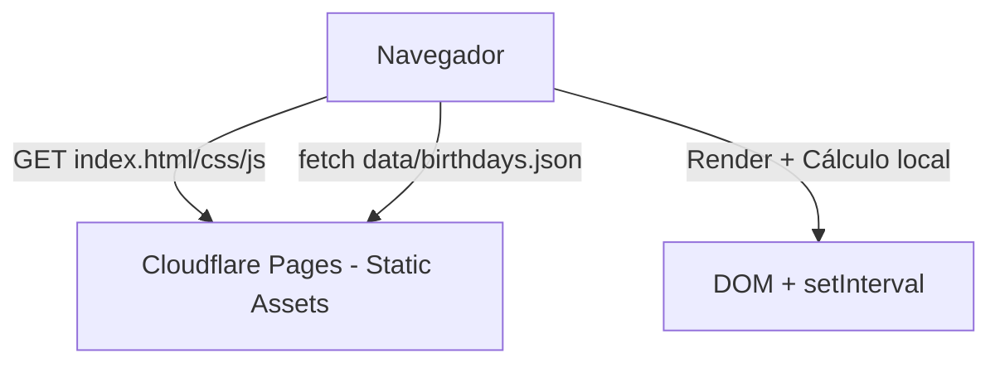
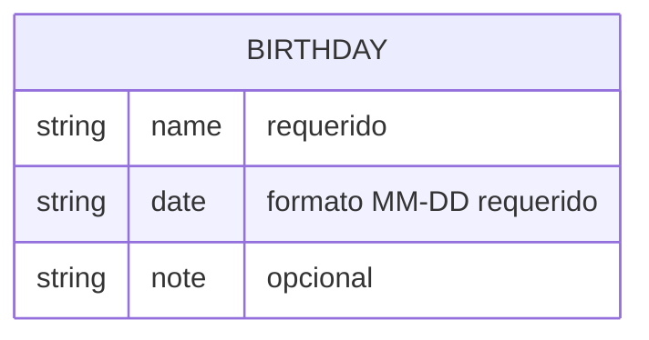
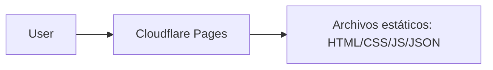

# Arquitectura y Diseño Técnico - Landing Maomao Birthday Time

## 1. Stack Tecnológico

| Capa | Tecnología | Justificación |
| :-- | :-- | :-- |
| Frontend | HTML5, CSS3, Vanilla JavaScript (ES6+) | Cumple RF-08: 100% estático, sin build step obligatorio, compatible con Cloudflare Pages. Sin dependencias externas. |
| Datos | JSON estático (`data/birthdays.json`) | Cumple RF-01/RN-02/RNF-06: datos desacoplados del código, modificables sin tocar lógica. |
| Estilos | CSS Variables (`:root` + `var()`) | Cumple RF-06/RNF-08/RN-05: personalización centralizada de colores. |
| Despliegue | Cloudflare Pages (static hosting) | Cumple RF-08/RNF-07: hosting estático, sin backend, sin variables obligatorias para MVP. |

**Decisión:** No se usan frameworks (React/Vue/Svelte), bundlers ni backend. Solución minimalista acorde al alcance.

## 2. Patrón Arquitectónico

**Patrón:** `Cliente estático (Static Client)` - Arquitectura sin servidor.

- **Tipo:** Monolito estático (archivos planos)
- **Razón:** Requerimientos son solo lectura, sin autenticación/persistencia/escritura (RN-03). Simplifica despliegue y elimina superficie de ataque.
- **Flujo:** Navegador → Solicita archivos estáticos → Renderiza HTML/CSS/JS → Carga JSON vía `fetch()` → Calcula y actualiza contadores con `setInterval`.



## 3. Modelado de Datos

Dado que es estático (sin base de datos), se define **solo el esquema JSON**.

### Esquema JSON
```json
[
  {
    "name": "string (requerido)",
    "date": "string MM-DD (requerido)",
    "note": "string (opcional)"
  }
]
```

**Reglas aplicables:** RN-01, RN-02

### Diagrama conceptual (sin persistencia)


## 4. Contratos / Interacciones

No hay endpoints API propios. Única interacción es carga de recurso estático.

| Acción | Método | Ruta | Payload | Respuesta | Notas |
| :-- | :-- | :-- | :-- | :-- | :-- |
| Carga de datos | GET | `./data/birthdays.json` | - | `200 OK` + array JSON | Rutas relativas. Manejar error si falla. |
| Carga de assets | GET | `./index.html`, `./css/styles.css`, `./js/*.js` | - | `200 OK` | Servidos por Cloudflare Pages |

## 5. Estructura de Archivos (Final Propuesta)

```text
/
├── index.html
├── css/
│   └── styles.css        # Usa variables CSS en :root
├── js/
│   ├── app.js            # Carga JSON, renderizado, orquestación
│   └── countdown.js      # Cálculo próximo cumpleaños + formato D/H/M/S
└── data/
    └── birthdays.json    # Datos estáticos
```

## 6. Topología de Infraestructura (Cloudflare Pages)



**Especificación:**
- **Hosting:** Cloudflare Pages (sitio estático)
- **Build:** Ninguno (direct upload / Git integration sin build command para MVP)
- **Dominio:** Opcional (subdominio `*.pages.dev` o custom domain)
- **HTTPS:** Proporcionado por Cloudflare
- **Variables de entorno:** Ninguna obligatoria
- **Rutas:** Relativas únicamente

## 7. ADRs (Architecture Decision Records)

### ADR-01: Sin backend / sin base de datos
- **Estado:** Aceptado
- **Contexto:** Alcance MVP solo lectura, datos controlados por mantenedor.
- **Decisión:** Usar JSON estático.
- **Consecuencias:** Despliegue trivial, sin costos de BD, sin auth. No soporta escritura desde UI (fuera de alcance).

### ADR-02: Vanilla JS en lugar de framework
- **Estado:** Aceptado
- **Contexto:** Proyecto pequeño, sin necesidad de SSR complejo, optimizar tamaño.
- **Decisión:** HTML/CSS/JS puro.
- **Consecuencias:** Sin build, bundle mínimo, fácil despliegue. Menor abstracción.

### ADR-03: Variables CSS para personalización de colores
- **Estado:** Aceptado
- **Contexto:** RF-06/RNF-08 exigen modificación de colores sin tocar lógica JS.
- **Decisión:** Centralizar en `:root { --color-* }` y usar `var()`.
- **Consecuencias:** Un solo punto de cambio, mantiene tema Maomao y facilita ajustes.

### ADR-04: Cálculo de próximo cumpleaños con lógica año actual/siguiente
- **Estado:** Aceptado
- **Contexto:** RN-01 - manejar fechas pasadas en año actual.
- **Decisión:** Comparar con fecha actual; si ya pasó, sumar 1 año.
- **Consecuencias:** Correcto todo el año, sin datos extra.

### ADR-05: Despliegue en Cloudflare Pages
- **Estado:** Aceptado
- **Contexto:** Requerido desplegar en Cloudflare Pages, estático.
- **Decisión:** Usar static hosting sin build step.
- **Consecuencias:** Rápido, gratuito para MVP, HTTPS automático, rutas relativas obligatorias.

## 8. Cumplimiento con RNF
| RNF | Cómo se cumple |
| :-- | :-- |
| RNF-01 | Sin dependencias externas, assets locales < 150 KB objetivo |
| RNF-02 | `setInterval` 1000ms, lógica pura en JS |
| RNF-03 | `textContent`/construcción controlada, sin `eval()`, evitar `innerHTML` con datos dinámicos |
| RNF-04 | Paleta Maomao con revisión de contraste |
| RNF-05 | Media queries 320px+ |
| RNF-06 | Datos en JSON separado |
| RNF-07 | Estático, rutas relativas, sin build obligatorio |
| RNF-08 | Variables CSS centralizadas |